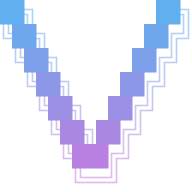

<p align="center">
  
</p>

`v` is a terminal tool for coding together with an AI agent: you and the agent take turns editing the same code.

What works now:

- an omnibox with commands: type `/` for a menu that filters as you type; Tab, Shift-Tab and arrows move the selection, Enter picks it;
- `/open [path]` opens a file with syntax highlighting or lists a directory; without a path it lists the working directory; paths complete on Tab;
- the file view has three modes, picked in the top right corner (Tab or a click): Flat, Unified diff and Side-by-side against git `HEAD`;
- screens stack up: Esc goes back one screen, down to the chat;
- `/config` edits `~/.v/settings.json`; for now it picks the color theme. Built-in themes are One Dark Pro (+ Darker), One Light and GitHub Dark/Light; any VS Code theme JSON dropped into `~/.v/themes/` shows up too;
- `v` connects to Claude Code at launch; anything typed without `/` goes to it (`claude -p`, signed in with your Claude subscription; `ANTHROPIC_API_KEY` is ignored). It runs Opus 5.5 with high effort. Replies stream into the chat as rendered markdown, and Ctrl-O shows the model's thinking; every file edit the agent proposes opens as a diff (Unified, Side-by-Side or Flat) to accept with `y` or reject with `n`, other tool calls ask `y / n` in the chat; Esc interrupts;
- `/reset` starts over with a fresh splash; `/q`, `/quit`, or Ctrl-D / Ctrl-C twice exits.

The plan:

- editing files in place;
- reviewing the agent's edits as diffs and changing them before they land.

## Build

Requires Go 1.27+ and a truecolor terminal (iTerm2, Ghostty, WezTerm, Kitty).

```sh
make build   # go build -o v .
make run     # build and start
make lint    # golangci-lint (brew install golangci-lint)
```

Or install into `$GOPATH/bin`:

```sh
go install github.com/dasimagin/v@latest
```

Quit with `/q` or press `Ctrl-D` twice.
